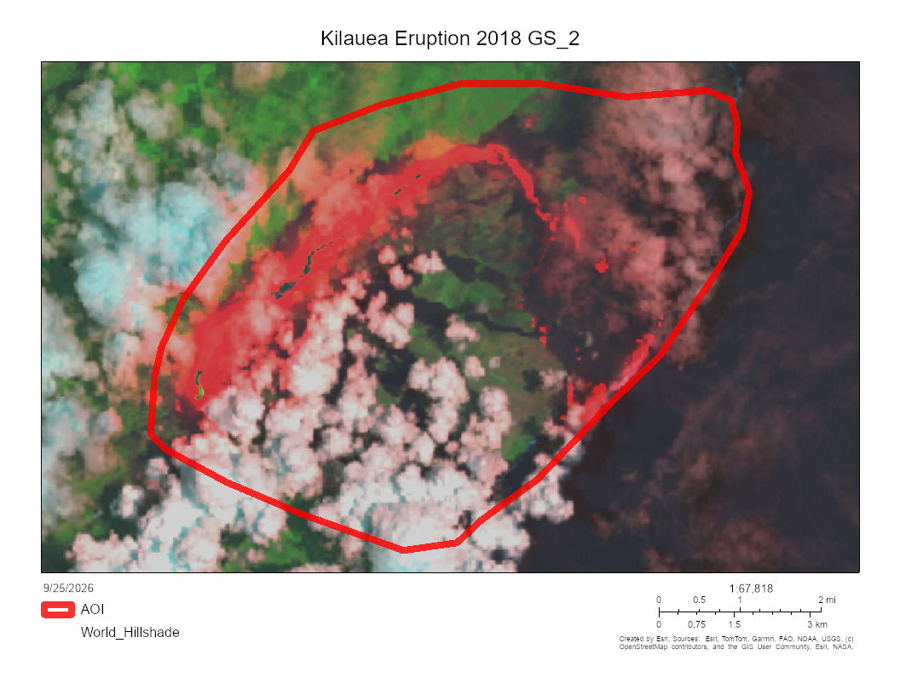

Gabriel Stewart

I'm studying emergency management at RCC to find a career in public service as a fire medic.Im using this GIS class to help me figure out different mapping programs and how to operate/become familiar with them. This class with help me in my career as a lot of what we do comes from mapping. 
---
2020 New York City covid 19 case rates

This map shows New York city in 2020 when covid was on the rise. Color coded case rates for each community showing the amount of case saturation and in what area.
This map answers the geographical question of where this was happening in new York and what was happening covid 19 case rates. It also shows cases as the unit of measure.
Data: NYC Department of Health and Mental Hygiene; U.S. Census Bureau. Map by Gabriel Stewart 09/04/2026. GEG 8, Riverside City College
For this picture we took a map of New York in 2020 using peak covid attributes and features. we duplicated layers, renamed copies, added features, and styled them. after that we sorted them by zip code, population density, and case rates to understand what is happening between all the layers we had made. 
I decided to color code the case rates by zip code to show what area had the most cases. I also chose a scale of light to dark red to yellow to show the numbers easier for the reader to understand. 
This map is limited to parts of New York and not any states or surrounding cities. Another limitation is fatalities. Case rates are great but someone wanting to know about covid and New York I think recorded deaths should be a top priority although I doubt anyone would ever give or get official numbers of that. 
Kilauea Eruption 2018

Kilauea Eruption 2018 shows what happen in Kilauea during the eruption phase as well as before and the aftermath
This map answers the geographical question of where this was happening and what was going on. It shows the different stages and the equipment used as these pictures use specialized equipment to be able to see the smoke lava and remains. 
Landsat-8 image courtesy of the U.S.
Geological Survey; Kilauea 2018 Lava Flow Extents courtesy of ESRI NASA, ERSI, TOMTOM, GARMIN, USGS, FAO,NOAA
using landsat8 satellite pictures taken and published online to create layers to show different times and satellite images of the before during and aftermath of the eruption. We then created a storymap with a dedicated slider app to show different times zones from the eruption while tracking the lava area and direction under all the smoke. 
I used a SWIR Landsat 8 picture to show beneath the smoke that no other camera feature would be able to show or get under to see the area of the lava. I chose this to tract where and how big the area of the lava was . 
Because I chose this a limitation of the map would be seeing how big the smoke ploom covered over the area obstructing the view from above. 
---

<https://storymaps.arcgis.com/stories/c451c90795d442a2be01b3015068c48c>

Data sources
 NYC Department of Health and Mental Hygiene; U.S. Census Bureau. Map by Gabriel Stewart 09/04/2026. GEG 8, Riverside City College
 
Landsat-8 image courtesy of the U.S.
Geological Survey; Kilauea 2018 Lava Flow Extents courtesy of ESRI NASA, ERSI, TOMTOM, GARMIN, USGS, FAO,NOAA

Where this is going
I plan to add all of the pictures I can upload into my GitHub but ive been reaching a couple complications I'm working out. Ive been frustrated on trying to upload pictures and finally figured it out. From converting compressing uploading and coding. Redlining chapter photos would be my next workload as I have a couple. I'm still trying to figure out how to add the GIS storybook as I see it as a really great and informative tool to others. I added the link but I want it to be displayed and auto started when visiting my page. I think blocking me is licensing issues i have to verify and make sure I'm using open source licensing as well as Apache 2.0. I want this page to show what I learned in this class about GIS as learned and hand on example provided above. 
